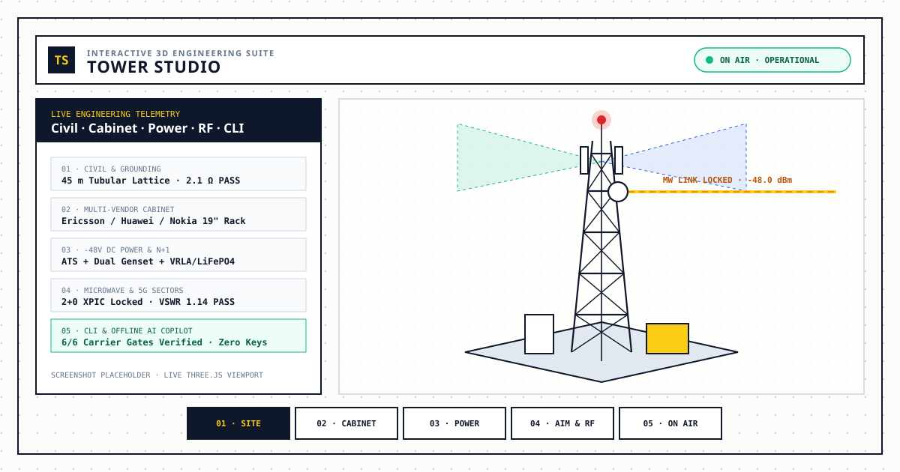

# Tower Studio

An interactive 3D telecom tower, power plant, 19-inch equipment cabinet, microwave backhaul, cellular RF, and offline AI site-engineering workbench that runs directly in your browser.

[](http://karanawzad.tech/Tower-Studio/)
[](./LICENSE)

---

## Live Demo & Preview

- **Live Application:** [http://karanawzad.tech/Tower-Studio/](http://karanawzad.tech/Tower-Studio/)
- **Interactive Demo Placeholder:** *(Add a screen-recording GIF or walkthrough video link here when ready)*



> *Tip: Replace `./assets/preview.svg` with a full-resolution viewport screenshot (for example `./assets/screenshot.png`) anytime you want to showcase a custom site build.*

---

## Key Features

Tower Studio turns complex telecommunications site engineering into an interactive, plain-English 3D learning and simulation studio:

- **3D Civil & Tower Engine (Step 01 · Site):** Choose between 4 site environments (*Mountain Peak*, *Urban Rooftop*, *Rural Greenfield*, and *Emergency Disaster COW*) and 7 engineered tower structures (3-leg tubular lattice, 4-leg angular lattice, rooftop RTT/DRAME on dunnage, parapet pole, light monopole, guyed mast, and telescopic COW truck). Includes live structural twist checks, perimeter security fencing, 70 mm² copper bonding, inspection earth pits, and lightning protection.
- **Multi-Vendor 19-Inch Cabinet & Alarm Highway (Step 02 · Open cabinet):** Inspect indoor and IP55 outdoor enclosures for **Ericsson**, **Huawei**, and **Nokia**. Swing open the 3D cabinet door, click individual rack cards (radios, baseband, power shelf, router, TDM, microwave modem), patch the animated yellow Router-to-TDM E1 cable, and trace external alarms from the surge box to the Network Operations Center (NOC).
- **AC/DC Power Plant & Blackout Simulator (Step 03 · Power):** Models the complete telecom power chain—commercial utility grid, single or dual alternating diesel generators, Automatic Transfer Switch (ATS), Main Distribution Board (MDB), −48 V DC bus, N+1 3 kW rectifier shelves, VRLA/Lithium battery banks, bulk fuel tank, and dual-split air conditioning. Trigger **Simulate Power Blackout** to watch 0.000 ms battery holdover, generator cranking, and 15-second ATS load transfer.
- **Microwave Backhaul & 2G–5G Cellular RF Workbench (Step 04 · Aim & Connect):**
  - *Microwave Backhaul:* Configure 1+0 Standalone, 1+1 Hot Standby, 1+1 Space Diversity, 2+0 XPIC, or 4+0 XPIC links across 0.3–2.4 m dishes and 7–38 GHz bands. Rotate azimuth from 0–360° or use **Auto-Peak** with a live virtual multimeter, received signal level (RSL), and fade-margin readout.
  - *Cellular Sectors & Virtual Site Master:* Manage three 120° sectors (Alpha, Beta, Gamma) across **2G, 3G, 4G LTE, 5G NR, and Mixed-Mode** profiles with azimuth, electrical RET downtilt, TX power, and bandwidth controls. Run 601-point VSWR / Distance-to-Fault cable sweeps to compare healthy feeders against simulated waterlogged connectors at 21.3 m.
- **Multi-Vendor CLI & Carrier Acceptance Audit (Step 05 · Go on air):** Open a docked console supporting **Ericsson Moshell / Router IPOS**, **Huawei BBU5900 MML**, and **Nokia AirScale CLI** commands backed by live 3D site state. Verify all 6 carrier acceptance gates before launching the animated **Go On Air** sequence and frequency-lock audio chime.
- **100% Local Offline AI Suite (Zero API Keys):**
  - *AI Architect Command Bar:* Type natural-language prompts (e.g., *"Safeen 4G mountain relay using 1+1 microwave and grid"*) or pick one of three preset blueprints (*Zagros Mountain 5G Relay*, *Urban Rooftop 4G/5G C-RAN*, *Emergency Border Outpost COW*) for a 3-second staged 3D build.
  - *AI Waveform Diagnostic:* Local rule-based classifier that inspects 601-point RF sweeps and explains healthy traces vs. capacitive water-ingress discontinuities.
  - *AI NOC Copilot:* Run `ai diagnose` (or click **AI Copilot**) in the terminal to correlate active alarms, power autonomy, and RF faults with three guided one-click remediation actions.

---

## Tech Stack

- **Frontend Markup & Layout:** Semantic HTML5, responsive CSS3 custom properties (desktop docked drawer + mobile touch-target layout with `prefers-reduced-motion` support)
- **3D Engine & Graphics:** [Three.js r128](https://threejs.org/) (orthographic CAD camera, procedural 3D meshes, raycast object picking) + inline dynamic SVG charts
- **Application Logic:** Vanilla ES6+ JavaScript (build-free execution, deterministic engineering & offline AI engines)
- **Audio & Typography:** Browser Web Audio API (procedural alignment tones & launch chime), Google Fonts (*Barlow*, *Barlow Condensed*, *Space Mono*)
- **Developer Tooling & CI:** Node.js (≥ 20), built-in `node:test` suite, ESLint, Prettier, EditorConfig, and GitHub Actions

---

## Project Structure

```text
Tower-Studio/
├── .github/
│   ├── ISSUE_TEMPLATE/
│   │   ├── bug_report.md          # Bug report template
│   │   ├── config.yml             # Issue template chooser config
│   │   └── feature_request.md     # Feature request template
│   ├── workflows/
│   │   └── ci.yml                 # Lint, test, and build CI pipeline
│   └── PULL_REQUEST_TEMPLATE.md   # Pull request checklist template
├── assets/
│   └── preview.svg                # Architectural preview graphic for documentation
├── docs/
│   ├── architecture.md            # System & state architecture overview
│   ├── deployment.md              # GitHub Pages & static hosting guide
│   ├── extending.md               # Guide to adding towers, cards, CLI & AI rules
│   └── technical-reference.md     # Detailed Phase 01–07 engineering reference
├── scripts/
│   ├── build.mjs                  # Validates assets/syntax and outputs dist/
│   └── dev-server.mjs             # Zero-dependency local HTTP development server
├── src/
│   ├── js/
│   │   └── app.js                 # Core 3D workbench, physics, CLI & offline AI logic
│   └── styles/
│       └── main.css               # Editorial CAD theme, drawer, HUD & responsive styles
├── tests/
│   └── app.test.mjs               # Automated structure, HTTP, and runtime smoke tests
├── .editorconfig                  # Cross-editor indentation & line-ending rules
├── .env.example                   # Optional local dev-server environment variables
├── .gitignore                     # Ignored dependencies, build artifacts & OS files
├── .prettierignore                # Files excluded from formatting
├── .prettierrc.json               # Prettier code formatting rules
├── CHANGELOG.md                   # Version history starting at 1.0.0
├── CONTRIBUTING.md                # Step-by-step contributor guide
├── eslint.config.mjs              # ESLint flat configuration
├── index.html                     # Root application entry point (GitHub Pages ready)
├── LICENSE                        # MIT License
└── package.json                   # Project metadata and npm scripts
```

---

## Installation & Run Instructions

Tower Studio has **zero build requirement** to run in a browser, and includes standard Node.js scripts for local development, linting, testing, and static bundling.

### Option A: Quick Start (No Node.js Required)

1. **Clone or download the repository:**
   ```bash
   git clone https://github.com/kara-nawzad/Tower-Studio.git
   cd Tower-Studio
   ```
2. **Open in your browser:**
   - Double-click `index.html` to open it directly in Chrome, Edge, Firefox, or Safari, **or**
   - Serve the folder locally with Python if installed:
     ```bash
     python3 -m http.server 3000
     ```
   - Visit `http://localhost:3000` in your browser. *(An internet connection is required on first load so the browser can fetch Three.js r128 and Google Fonts from their CDNs.)*

### Option B: Developer Setup (Node.js ≥ 20)

1. **Clone the repository and enter the folder:**
   ```bash
   git clone https://github.com/kara-nawzad/Tower-Studio.git
   cd Tower-Studio
   ```
2. **Install development tools (ESLint, Prettier, test helpers):**
   ```bash
   npm install
   ```
3. **(Optional) Create your local environment file:**
   ```bash
   cp .env.example .env
   ```
4. **Start the local development server:**
   ```bash
   npm run dev
   ```
5. **Open the workbench in your browser:**
   Visit `http://localhost:3000`.
6. **Run quality checks, tests, and production bundle verification:**
   ```bash
   npm run lint
   npm test
   npm run build
   ```

---

## Configuration & Environment Variables

The Tower Studio web application runs **100% client-side in the browser**. All AI Architect parsing, RF waveform diagnostics, and NOC Copilot triage run locally in JavaScript—**no API keys, cloud accounts, or backend databases are needed**.

For the local Node.js development server (`scripts/dev-server.mjs`), optional settings can be configured in a `.env` file (see [`.env.example`](./.env.example)):

| Variable | Default | Description |
| --- | --- | --- |
| `HOST` | `0.0.0.0` | Network interface the local development server binds to |
| `PORT` | `3000` | TCP port for `npm run dev` / `npm start` |
| `NODE_ENV` | `development` | Runtime environment label (`development` or `production`) |

---

## Usage Guide

1. **Explore the 3D Site:**
   - **Drag** anywhere on the canvas to orbit around the tower.
   - **Scroll** (or pinch on touchscreens) to zoom in and out, or click **FIT SITE** in the top bar to re-center.
   - **Click** any 3D object—tower legs, earth pits, generator, cabinet door, rack cards, microwave dishes, or cellular antennas—to inspect what it is, what it does, and why the site needs it.
2. **Follow the 5 Master Steps (Bottom Navigation Bar):**
   - **Step 01 · Site:** Pick an environment (such as *Mountain Peak* or *Urban Rooftop*) and adjust tower type, height, grounding, and lightning protection under the **Configure** tab.
   - **Step 02 · Open cabinet:** Select a vendor (*Ericsson*, *Huawei*, or *Nokia*), swing open the cabinet door, toggle rack modules, test the yellow Router-to-TDM cable patch, or trace the external alarm path.
   - **Step 03 · Power:** Configure commercial grid vs. dual generators, battery strings, and rectifier count, or click **Simulate Power Blackout** to observe backup failover in real time.
   - **Step 04 · Aim & Connect:** Switch between **Microwave Backhaul** (click **Auto-Peak** to lock the dish alignment) and **Cellular Sectors** (adjust sector azimuth/tilt or run a **Virtual Site Master** cable sweep).
   - **Step 05 · Go on air:** Check the 6-gate Carrier Acceptance checklist. Once all six checks show green `✓`, click **GO ON AIR**—or click **TERMINAL** to run vendor CLI commands (`lt all`, `cabx`, `LST ALM:;`, `show bts status`, `ai diagnose`).
3. **Build Instantly with AI Architect:**
   - Use the search bar beneath the header to click a preset chip (e.g., **Zagros Mountain 5G Relay**) or type your own site description and press **AI BUILD**.

For deep engineering formulas, CLI command tables, and link-budget equations, see [`docs/technical-reference.md`](./docs/technical-reference.md).

---

## Roadmap

Planned enhancements for future releases (not yet implemented):

- [ ] Exportable PDF / JSON Site Acceptance Report and Bill of Materials (BOM)
- [ ] Shareable URL state links to bookmark and send custom site configurations
- [ ] Offline-first Service Worker caching Three.js and font assets for zero-network field use
- [ ] Solar PV + hybrid DC power plant option for remote off-grid greenfield towers
- [ ] Fiber-to-the-Tower (FTTT) optical Ring/DWDM backhaul topology alongside microwave hops

---

## Contributing

Contributions, bug reports, and telecom engineering improvements are welcome! Please read [`CONTRIBUTING.md`](./CONTRIBUTING.md) for simple step-by-step instructions on setting up the project, running checks, and submitting a pull request.

---

## License

This project is open-source software licensed under the [MIT License](./LICENSE).

---

## Author

**Kara Nawzad Hassan**

- **GitHub:** [@kara-nawzad](https://github.com/kara-nawzad)
- **Portfolio:** [http://karanawzad.tech/](http://karanawzad.tech/)
